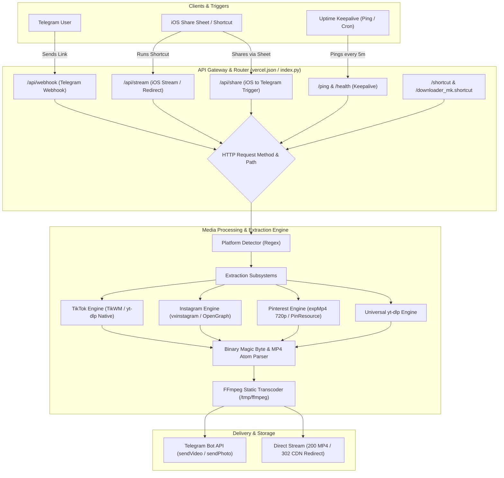
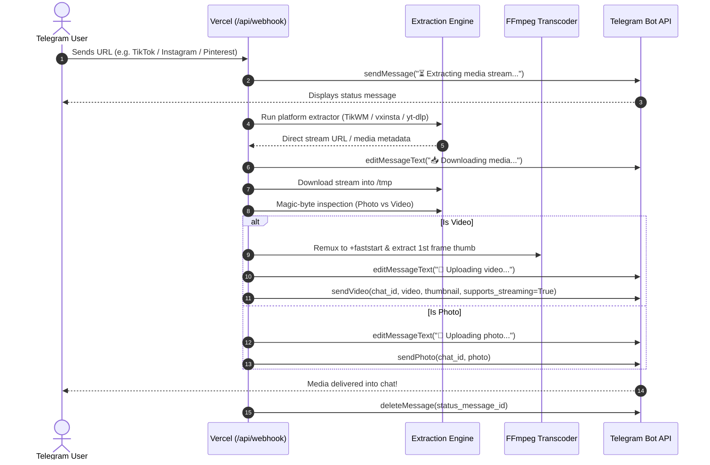
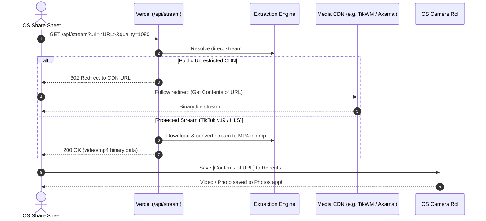

# Universal Media Downloader Bot & iOS Shortcut: Complete Architecture & System Blueprint

This document outlines the complete architectural design, component roles, data pipelines, media processing workflows, and step-by-step modification guide for building a similar or customized media downloader bot.

---

## 1. Executive Summary & Core Concept

The bot is a hybrid, multi-client media downloading backend designed to run **24/7 serverless on Vercel (or containerized on Render/Docker)** with **zero hosting costs**.

It serves two client interfaces simultaneously using one unified media extraction engine:
1. **Telegram Bot Client (`@vidsmkdownloaderbot`)**: Interacts via Telegram Webhooks (`/api/webhook`). Accepts media URLs, streams real-time status updates ("Downloading...", "Uploading..."), processes and packages video/photo files up to 50 MB, and sends them directly into the Telegram chat with native aspect ratios, custom thumbnails, and faststart streaming.
2. **Apple iOS Shortcut Client**: Interacts via HTTP API (`/api/stream?url=...`). Integrated into the native iOS Share Sheet, it resolves direct CDN URLs or converts streams on the fly to download videos and photos directly into the iPhone's Camera Roll (Recents) without third-party apps.

---

## 2. Technology Stack & Dependencies

| Layer | Technology | Purpose |
| :--- | :--- | :--- |
| **Runtime Environment** | Python 3.9+ / Linux x86_64 | Core application language |
| **Serverless Platform** | Vercel Serverless Functions (`api/index.py`) | Microservice execution, global CDN routing |
| **Standalone Daemon** | `bot.py` (Aiogram 3 / Docker) | Alternative long-polling runner for VPS / Render |
| **HTTP Server Engine** | Python `http.server.BaseHTTPRequestHandler` | Lightweight serverless request handler (zero external framework overhead) |
| **Universal Extractor** | `yt-dlp` | Universal video/audio extraction for 1000+ sites with JS challenge solving |
| **Media Transcoding** | Static FFmpeg 6.1 (auto-provisioned in `/tmp`) | Audio + Photo mixing, MP4 faststart remuxing, frame thumbnailing |
| **Networking & APIs** | `requests`, `aiohttp`, `urllib` | Webhook polling, third-party API queries, chunked binary streaming |
| **Binary Stream Parser** | Pure Python `struct` | In-memory MP4 atom parser (`moov`, `tkhd`, rotation matrix, magic bytes) |

---

## 3. Directory & Repository Structure

```
botdownloaderbymk/
├── .env                     # Local environment credentials (gitignored)
├── .env.example             # Template for required environment variables
├── .gitignore               # Excludes venv, pycache, .env, temp artifacts
├── Dockerfile               # Production container build for VPS or Render
├── requirements.txt         # Python package dependencies
├── vercel.json              # Vercel serverless routes, rewrites, and execution limits
├── bot.py                   # Long-polling standalone runner (Aiogram 3)
└── api/
    └── index.py             # Main Serverless Monolith (Telegram Webhook, iOS Streamer, Extractors)
```

---

## 4. Architectural Roles & Component Overview



---

## 5. Detailed Component Breakdown & Roles

### 5.1. Entry Gateway & Request Handler (`api/index.py::handler`)
Inherits from `http.server.BaseHTTPRequestHandler`. Acts as the single entrypoint for all incoming HTTP requests:

* **`POST /api/webhook`**: Receives JSON webhook payloads from Telegram.
  - Spawns background threads or executes inline media processing (`process_url_and_reply`).
  - Immediately acknowledges Telegram with `200 OK` to prevent retry floods.
* **`GET /api/stream?url=<URL>&quality=<Q>`**: Serves the iOS Shortcut.
  - Evaluates direct media URLs.
  - Returns `302 Found` (redirect) for open CDNs (allowing high-speed zero-hop download straight to the device).
  - Returns `200 OK` with raw `video/mp4` binary streaming for protected CDNs (like TikTok JS challenge streams) or converted HLS playlists (Pinterest/Instagram).
* **`GET /api/share?url=<URL>&chat_id=<ID>`**: Allows an iOS Shortcut to dispatch any URL directly to the user's Telegram chat.
* **`GET /ping` & `/health`**: Returns JSON `{"status": "pong"}` for monitoring services (e.g. UptimeRobot, cron-job.org).
* **`GET /shortcut` & `GET /downloader_mk.shortcut`**: Dynamically serves the iOS Shortcut download landing page and binary `.shortcut` file.

---

### 5.2. Platform-Specific Extractors

#### A. TikTok Subsystem (`extract_tiktok_direct`)
* **Strategy:** Dual-layer redundancy.
  1. **Primary Layer:** Queries TikWM APIs (`https://tikwm.com/api/` and `https://www.tikwm.com/api/`). Extracts watermark-free MP4 streams (`play` or `hdplay`), cover photos, audio tracks, or photo slideshow arrays.
  2. **Fallback Layer:** If TikWM times out or fails, engages `yt-dlp`'s built-in Python TikTok challenge solver.
  3. **403 CDN Bypass:** TikTok's direct CDN links (`v19-webapp-prime...`) reject generic HTTP requests. The system intercepts these links and downloads them using `yt-dlp`'s native authenticated session manager directly to `/tmp`.

#### B. Instagram Subsystem (`extract_instagram_direct`)
* **Strategy:** High-speed gateway queries without requiring user login credentials.
  1. Emulates TwitterBot/TelegramBot crawler headers against `vxinstagram.com/reel/<shortcode>/` to extract direct OpenGraph video/image URLs.
  2. Falls back to direct page parsing via OpenGraph metadata (`og:video`, `og:image`).
  3. Handles single photos, video reels, and multi-asset carousels.

#### C. Pinterest Subsystem (`extract_pinterest_direct`)
* **Strategy:** Direct 720p audio-inclusive MP4 extraction.
  1. Follows `pin.it` short-url 301/302 redirects to extract the canonical Pin ID.
  2. Scrapes the web HTML for pre-rendered direct audio-muxed MP4s (`https://v1.pinimg.com/videos/iht/expMp4/...`).
  3. Queries the official Pinterest `PinResource/get` internal API to extract highest bitrate streams (`V_720P`, `V_EXP7`, `V_480P`).
  4. If only an HLS (`.m3u8`) stream is available, passes it to the transcoder to produce a true MP4 with audio.

#### D. Universal yt-dlp Subsystem
* Extracts info with `extract_info(url, download=False)`.
* Filters format lists in reverse order to identify the highest quality progressive MP4 with active video (`vcodec != 'none'`) and audio (`acodec != 'none'`).
* Accurately distinguishes photo posts (where only image thumbnails exist) from video posts.

---

### 5.3. Media Processing & Transcoding Engine

#### A. Static FFmpeg Provisioner (`ensure_ffmpeg`)
* Checks if `ffmpeg` exists in system `PATH`.
* In Vercel's read-only serverless Linux container, `/tmp` is the only writable directory. If running on Linux x86_64, it automatically downloads a precompiled static binary (`ffmpeg-6.1-linux-64.zip`) into `/tmp/ffmpeg`, gives it executable permissions (`chmod 0o755`), and caches it across serverless invocations.

#### B. MP4 Faststart Optimizer
* Raw video streams from CDNs often place the index container (`moov` atom) at the end of the file. This breaks inline streaming on mobile clients.
* The engine executes:
  ```bash
  ffmpeg -y -i input.mp4 -c copy -movflags +faststart output.mp4
  ```
* This takes less than **150 milliseconds** (since `-c copy` does not re-encode) and moves the index to the front, enabling instant streaming in Telegram and iOS Photos.

#### C. Video Frame Thumbnail Generator
* Avoids aspect-ratio distortion caused by mismatched external cover images (e.g. portrait cover on a landscape video).
* Extracts a clean 1-frame JPEG directly from timestamp `00:00:00.200` of the converted video:
  ```bash
  ffmpeg -y -ss 00:00:00.200 -i video.mp4 -vframes 1 -q:v 2 thumb.jpg
  ```
* This guarantees that Telegram's preview bubble matches the exact aspect ratio, orientation, and resolution of the video.

#### D. Photo + Music Multiplexer (`mix_image_and_audio`)
* If a post consists of a static photo with an audio track (common on TikTok and Instagram):
* Executes a high-performance FFmpeg filter graph:
  ```bash
  ffmpeg -y -loop 1 -i photo.jpg -i music.mp3 -c:v libx264 -tune stillimage -c:a aac -b:a 192k -pix_fmt yuv420p -vf scale=trunc(iw/2)*2:trunc(ih/2)*2 -shortest -movflags +faststart output.mp4
  ```
* Generates a fully compliant H.264/AAC MP4 video playable on any device.

#### E. Binary Magic Byte & Atom Parser (`extract_mp4_dimensions` & `get_video_info_fast`)
* Inspects the first 16 bytes of downloaded data to differentiate JPEG (`\xff\xd8\xff`), PNG (`\x89PNG`), WEBP (`WEBP`), and MP4 (`ftyp`).
* Reads the MP4 `tkhd` box to parse width, height, and the 36-byte transformation matrix (checking matrix indices `b` and `c` for 90° or 270° display rotations).

---

## 6. Execution Sequences

### 6.1. Telegram Bot Pipeline


---

### 6.2. iOS Shortcut Pipeline


---

## 7. Configuration & Environment Variables

| Variable | Description | Example |
| :--- | :--- | :--- |
| `BOT_TOKEN` | Telegram Bot Token obtained from `@BotFather` | `1234567890:ABCdefGHI...` |
| `USER_CHAT_ID` | Telegram numerical Chat ID for administrative notifications | `2140565223` |
| `PING_URL` | Self-ping URL used to keep the serverless instance warm | `https://your-app.vercel.app/ping` |
| `PORT` | Local runner port (for `bot.py` or Docker) | `8080` |

---

## 8. How to Build & Modify a Custom Variant

To build your own version of this bot with modified behavior, follow these steps:

### Step 1: Clone the Project
```bash
git clone https://github.com/mkalgo1/botdownloaderbymk.git my-custom-downloader
cd my-custom-downloader
```

### Step 2: Configure Environment
Create a `.env` file in the root:
```env
BOT_TOKEN=your_bot_token_from_botfather
USER_CHAT_ID=your_telegram_numeric_id
```

### Step 3: Common Customizations
1. **Change Bot Personality / Captions:**
   In `api/index.py`, locate `caption_text`:
   ```python
   caption_text = f"🎬 {platform['emoji']} {platform['name']}\n\n📌 {title[:80]}"
   ```
   Modify it to add custom branding, channel links, or credit tags:
   ```python
   caption_text = f"✨ **Downloaded by MyCustomBot**\n📺 **Source:** {platform['name']}\n🔗 Join @MyChannel"
   ```

2. **Add / Restrict Platforms:**
   Locate `PLATFORMS` in `api/index.py`:
   ```python
   PLATFORMS = {
       "tiktok": {"name": "TikTok", "emoji": "🎵", "domains": [...]},
       "instagram": {"name": "Instagram", "emoji": "📸", "domains": [...]},
       ...
   }
   ```
   Add new domain matches or comment out platforms you wish to disable.

3. **Adjust Video Quality Limits:**
   In `handler::do_GET` under `/api/stream`:
   ```python
   q_height = int(query.get("quality", ["0"])[0])
   ```
   You can enforce maximum output resolution (e.g., clamp to `720` to conserve bandwidth).

### Step 4: Deploy to Vercel
1. Install Vercel CLI:
   ```bash
   npm install -g vercel
   ```
2. Deploy directly:
   ```bash
   vercel --prod
   ```
3. Set your webhook with your new deployment URL:
   Visit in your browser:
   `https://your-deployment.vercel.app/setup`
   The bot will automatically register its Telegram webhook!
